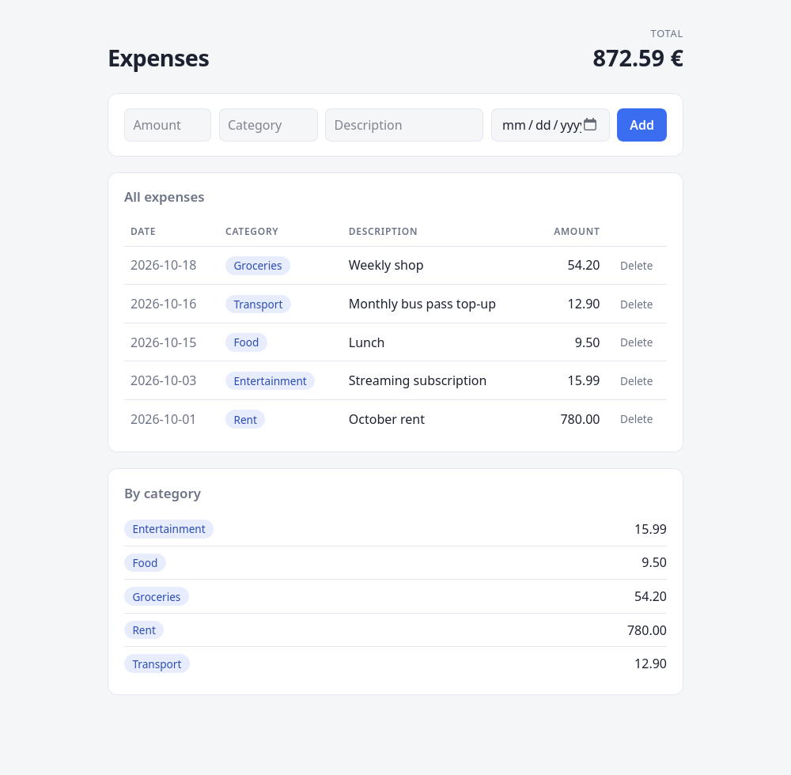

# ExpenseTracker

Small Flask + SQLite web app for tracking personal expenses. Add expenses with an amount, category, description and date, see the total and per-category totals, and delete entries.



## Setup

```bash
python -m venv .venv
source .venv/bin/activate
pip install -r requirements.txt
```

## Run

```bash
python app.py
```

Open http://127.0.0.1:5000. The SQLite database (`expenses.db`) is created next to the app on first run.

**Local use only:** there is no authentication or CSRF protection, and the app runs with `debug=True`. Don't expose it to a network or deploy it as is.

## Tests

```bash
pip install -r requirements-dev.txt
pytest
```

Tests use a temporary database, so your real `expenses.db` is never touched.

## Layout

- `app.py` – Flask routes and input validation
- `database.py` – SQLite access
- `templates/`, `static/` – HTML and CSS
- `tests/` – pytest tests for validation, database functions and routes

## About

The initial version was hand-coded as a practice project to remind myself of the tech behind a small web app. Development continues with Claude Code (security checks, polish, new features).

The original project was written before version control was set up, which is why the Git history starts on 20.10.2026.

Tech and concepts used:
- Flask routes and form handling
- Jinja templates
- Raw `sqlite3` with parameterized queries
- POST-redirect-GET pattern
- Server-side input validation

Ideas for later: edit expenses, filter by month, CSV export.

## License

MIT, see [LICENSE](LICENSE).
